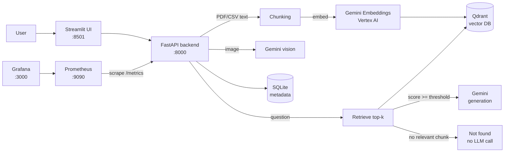

# LLMOps Multimodal RAG Chatbot

A production-style **Retrieval-Augmented Generation (RAG)** chatbot that answers questions about PDFs, CSVs and images, built with **FastAPI, Qdrant, Google Gemini (Vertex AI) and Streamlit**, and instrumented end to end with **Prometheus and Grafana**.

The goal of this project is not only to build a chatbot, but to run it the way an LLM system should be run in production: observable, cost-aware, guarded, reproducible and safe with secrets.

---

## Features

**Multimodal question answering**
- **PDF and CSV:** text is extracted, chunked, embedded with `gemini-embedding-001` and stored in Qdrant for semantic search.
- **Images (JPG/PNG):** answered directly with Gemini vision.
- **Multi-document search:** ask one question across all indexed documents, with source filenames in the answer.

**LLMOps capabilities**
- **Relevance guardrail:** chunks below a configurable similarity threshold are never sent to the LLM. Off-topic questions are answered with "not found" at zero token cost.
- **Prompt-injection defense:** retrieved text is wrapped in `<document>` tags and treated as untrusted data; text inside images is never followed as instructions.
- **Versioned prompts:** every response includes a `prompt_version`, so quality changes can be traced to prompt changes.
- **Retries with exponential backoff** for Gemini rate limits (429) and transient 5xx errors.
- **Idempotent indexing:** document IDs are SHA-256 content hashes and point IDs are deterministic UUIDv5s, so re-uploading a file never creates duplicates.
- **Row-aware CSV chunking:** CSV rows are never split across chunks.
- **Token usage tracking**, including thinking tokens, per request and as metrics.

**Observability**
- HTTP request rate, latency and status codes (labeled by route template to avoid label-cardinality explosions)
- Per-operation Gemini latency and errors (embed, RAG generation, vision, general chat)
- Retrieval latency, top similarity score per query (a drift signal) and no-match count
- Input, output and total token counters per model

**Operations**
- Fully containerized with Docker Compose (UI, API, Qdrant, Prometheus, Grafana)
- Pinned image and package versions for reproducible builds
- Health checks with ordered startup (UI waits for a healthy API, API waits for a healthy Qdrant)
- Persistent storage for vectors, metadata and uploaded files

---

## Architecture



**Request flow for a document question**
1. The question is embedded with the `RETRIEVAL_QUERY` task type.
2. Qdrant returns the top-k most similar chunks, optionally filtered to one document.
3. Chunks below `MIN_SIMILARITY` are dropped. If none remain, the API answers "not found" without calling the LLM.
4. Remaining chunks are wrapped in `<document>` tags and sent to Gemini with a versioned prompt.
5. The answer, retrieved chunks, similarity scores, prompt version and token usage are returned and recorded as metrics.

---

## Tech stack

| Layer | Technology |
|---|---|
| LLM and embeddings | Google Gemini via Vertex AI (`google-genai`) |
| Vector database | Qdrant |
| API | FastAPI, Uvicorn |
| UI | Streamlit |
| Document parsing | PyMuPDF |
| Metadata store | SQLite |
| Monitoring | Prometheus, Grafana, `prometheus-client` |
| Deployment | Docker, Docker Compose |

---

## Project structure

```
.
├── app/
│   └── main.py                 # FastAPI backend: ingestion, RAG, vision, metrics
├── ui.py                       # Streamlit frontend
├── evaluation/
│   ├── evaluation_dataset.json # Question / ground-truth / reference-context set
│   ├── qdrant_test_document.pdf
│   ├── extract_pdf.py
│   └── api_schema.json         # OpenAPI schema snapshot
├── monitoring/
│   └── prometheus/prometheus.yml
├── docker-compose.yml
├── Dockerfile.backend
├── Dockerfile.ui
├── requirements.txt            # Backend dependencies (pinned)
├── requirements-ui.txt         # UI dependencies (pinned)
└── .env.example                # All settings, without secrets
```

---

## Getting started

### Prerequisites
- Docker Desktop
- A Google Cloud project with the **Vertex AI API** enabled
- A service account with the **Vertex AI User** role and a JSON key

### 1. Clone and configure

```bash
git clone https://github.com/ramdodda/llmops-multimodal-rag-chatbot.git
cd llmops-multimodal-rag-chatbot
cp .env.example .env
```

Edit `.env` and set at least `GOOGLE_CLOUD_PROJECT`. Save your service-account key in the project root as `vertex-credentials.json`. Both files are git-ignored.

### 2. Run

```bash
docker compose up -d --build
docker compose ps
```

Wait until `llmops-backend` and `llmops-qdrant` report **healthy**.

### 3. Open

| Service | URL |
|---|---|
| Chat UI | http://localhost:8501 |
| API docs (Swagger) | http://localhost:8000/docs |
| API health | http://localhost:8000/health |
| Prometheus metrics | http://localhost:8000/metrics |
| Prometheus | http://localhost:9090 |
| Grafana | http://localhost:3000 |
| Qdrant dashboard | http://localhost:6333/dashboard |

In Grafana, add Prometheus as a data source with the URL `http://prometheus:9090`.

---

## Configuration

| Variable | Default | Purpose |
|---|---|---|
| `GOOGLE_CLOUD_PROJECT` | (required) | Google Cloud project for Vertex AI |
| `GOOGLE_CLOUD_LOCATION` | `global` | Vertex AI location |
| `GOOGLE_GENAI_MODEL` | `gemini-3.1-pro-preview` | Generation model |
| `MIN_SIMILARITY` | `0.5` | Minimum cosine similarity for a chunk to reach the LLM |
| `MAX_LLM_ATTEMPTS` | `3` | Retry attempts for 429 / 5xx errors |
| `ENABLE_TEST_ROUTES` | `false` | Enables `/test-error` for alert testing |
| `QDRANT_VERSION` | (required) | Pinned Qdrant image tag |
| `PROMETHEUS_VERSION` | (required) | Pinned Prometheus image tag |
| `GRAFANA_VERSION` | (required) | Pinned Grafana image tag |

---

## API

| Method | Endpoint | Description |
|---|---|---|
| `POST` | `/upload-file` | Upload a PDF, CSV, JPG or PNG (max 20 MB) |
| `POST` | `/ask-file` | Ask about one document, an image, or all documents (`document_id: "__all__"`) |
| `POST` | `/ask` | General Gemini chat without document context |
| `GET` | `/documents` | List uploaded documents |
| `POST` | `/select-document` | Set the active document |
| `GET` | `/health` | API and Qdrant health |
| `GET` | `/metrics` | Prometheus metrics |

Example:

```bash
curl -X POST http://localhost:8000/ask-file \
  -H "Content-Type: application/json" \
  -d '{"question": "Which vector database does this chatbot use?", "top_k": 4, "document_id": "__all__"}'
```

---

## Monitoring

Useful PromQL queries for Grafana panels:

```promql
# p95 Gemini latency by operation
histogram_quantile(0.95, sum by (le, operation) (rate(llmops_llm_call_duration_seconds_bucket[5m])))

# Tokens per minute
sum(rate(llmops_gemini_total_tokens_total[5m])) * 60

# API error rate
sum(rate(llmops_http_requests_total{status=~"5.."}[5m]))
  / sum(rate(llmops_http_requests_total[5m]))

# Share of questions with no relevant chunk
rate(llmops_retrieval_no_match_total[15m])
  / rate(llmops_retrieval_duration_seconds_count[15m])

# Median best-match similarity (a falling value suggests drift)
histogram_quantile(0.5, rate(llmops_retrieval_top_similarity_bucket[1h]))
```

---

## Lessons learned

- **Blocking work in `async def` freezes the server.** Upload processing was moved to a sync endpoint so FastAPI runs it in a threadpool.
- **Thinking tokens can dominate cost.** On simple lookups, thinking tokens were about 12× the answer tokens, which makes reasoning budgets an important cost lever for RAG.
- **A similarity threshold is both a quality and a cost control.** Off-topic questions previously cost about 700 tokens to produce "not found"; now they cost nothing.
- **Metric labels must have bounded values.** Labeling by raw URL lets any bot create unlimited time series; labeling by route template does not.
- **`latest` tags are not reproducible.** Images and packages are pinned to tested versions.

---

## Limitations and roadmap

- [ ] Automated evaluation runner (retrieval hit rate, faithfulness, answer correctness) in CI
- [ ] OCR fallback for scanned PDFs using Gemini vision
- [ ] PII masking on model outputs
- [ ] Delete endpoint for uploaded documents
- [ ] Configurable thinking budget for cost control
- [ ] Grafana dashboards and data source provisioned as code
- [ ] Conversation memory for follow-up questions
- [ ] Authentication and per-user document isolation (the active document is currently shared process-wide)

---

## Security notes

- Secrets (`.env`, service-account keys) and runtime data (`data/`) are excluded via `.gitignore` and `.dockerignore`.
- Credentials are mounted into the backend container read-only at runtime and are never baked into images.
- Uploaded files are stored locally and sent to Vertex AI for processing, so avoid uploading sensitive personal documents to a test deployment.
